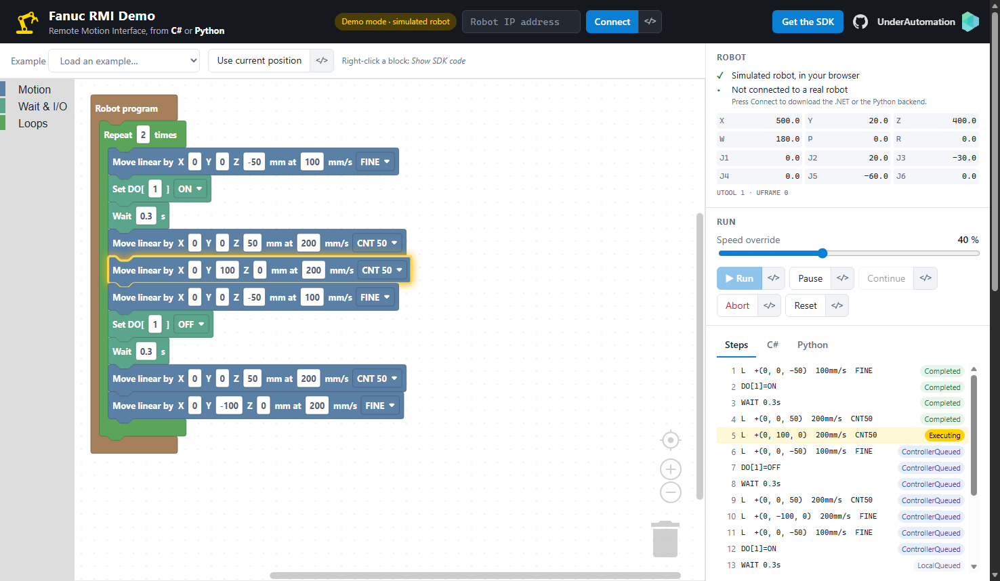

# Fanuc RMI Demo

Build a robot sequence with blocks, press **Run**, and watch a real Fanuc robot execute it, driven from **C#** or from **Python**.

This demo shows what the [UnderAutomation Fanuc SDK](https://underautomation.com/fanuc) does with the **Remote Motion Interface (RMI)** of Fanuc controllers: your PC sends joint and linear motions, waits and I/O to the robot, and follows each instruction while it runs. Nothing is installed on the controller, and no TP or Karel program is written. It is the base of applications such as palletizing, pick and place or machine tending, where the PC decides the positions.



**Try it now: [fanuc-rmi-demo.underautomation.com](https://fanuc-rmi-demo.underautomation.com)**

## What you can do

- **Build a sequence** with blocks: joint and linear motions, relative motions, FINE or CNT, waits, digital inputs and outputs, loops and a pallet pattern.
- **Run it** on your robot and see the block that the robot is executing, and the status of every instruction: `LocalQueued`, `ControllerQueued`, `Executing`, `Completed`.
- **Read the code.** The _C#_ and _Python_ tabs show the complete program of your sequence, ready to paste in your project. Each button has a `</>` twin that shows the SDK calls behind it, and each block has _Show SDK code_ in its right-click menu.
- **Get help when the robot is not ready.** The page tells you what to check: wrong IP address, missing option, teach pendant enabled, alarm, and so on.

## Three ways to use it

All three give the same page and the same features. Without a backend, the page runs in **demo mode** on a simulated robot.

### 1. The web site, plus a backend to download

A web page cannot talk to a robot. A small backend on your PC does it, and the web site finds it on `http://localhost:16080`.

1. Open [fanuc-rmi-demo.underautomation.com](https://fanuc-rmi-demo.underautomation.com) and play with the simulated robot.
2. Press **Connect** and download one of the two backends. Both do the same:
   - **.NET**: [`FanucRmiDemo.exe`](https://github.com/underautomation/fanuc-rmi-demo/releases/latest/download/FanucRmiDemo.exe). Windows 64 bits, one file. The .NET runtime is inside: nothing to install, not even .NET. Start it and answer `y` to open the page.
   - **Python**: [`fanuc-rmi-demo-python.zip`](https://github.com/underautomation/fanuc-rmi-demo/releases/latest/download/fanuc-rmi-demo-python.zip). Unzip it, then:
     ```bash
     pip install -r requirements.txt
     python app.py
     ```
3. Back on the web site, press **Retry**, enter the IP address of the robot and press **Connect**. If the browser asks to access devices on your local network, allow it.

The backend also serves the page itself on [http://localhost:16080](http://localhost:16080): the PC of the robot cell does not need Internet.

Quit a backend with `Ctrl+C`: it ends the RMI session. A backend that is killed leaves `RMI_MOVE` selected on the controller, and the next run is refused until another program is selected on the teach pendant.

### 2. Run the .NET project

Needs the [.NET 9 SDK](https://dotnet.microsoft.com/download), only to build from the sources: the downloaded `FanucRmiDemo.exe` needs nothing.

```bash
git clone https://github.com/underautomation/fanuc-rmi-demo.git
cd fanuc-rmi-demo/src/Backend.DotNet
dotnet run
```

### 3. Run the Python project

Needs Python 3.7 to 3.13. On Linux and macOS, also install a .NET runtime (for example `dotnet-runtime-8.0`): the Python package of the SDK runs on it.

```bash
git clone https://github.com/underautomation/fanuc-rmi-demo.git
cd fanuc-rmi-demo/src/Backend.Python
python -m venv .venv
.venv\Scripts\activate          # Linux and macOS: source .venv/bin/activate
pip install -r requirements.txt
python app.py
```

## Prepare the robot

| What                                    | How                                                                                     |
| --------------------------------------- | --------------------------------------------------------------------------------------- |
| Option **R912** Remote Motion Interface | Installed on the controller. `MENU > STATUS > Version ID > ORDER FI` lists the options. |
| Network                                 | The PC reaches the robot on TCP port **16001**.                                         |
| Mode switch                             | **AUTO**                                                                                |
| Teach pendant                           | Switch on **OFF**                                                                       |
| Alarms                                  | None active. Press `RESET`.                                                             |
| Selected program                        | Not `RMI_MOVE`. If it is, `SELECT` another program.                                     |

No robot at hand? The demo also runs on a [ROBOGUIDE](https://underautomation.com/fanuc/documentation/simulator) virtual robot.

### When something goes wrong

The page explains each of these cases next to the robot status.

| What you see                                                 | What it means                                      | What to do                                                                                                  |
| ------------------------------------------------------------ | -------------------------------------------------- | ----------------------------------------------------------------------------------------------------------- |
| _No answer from this address_                                | The PC cannot reach the robot                      | Check the IP address (`MENU > SETUP > Host Comm > TCP/IP`), the cable and the subnet of the PC.             |
| _Nothing listens on the RMI port_                            | The robot answers, port 16001 is closed            | Install the option R912. After the installation, restart the controller. Open the port in the firewalls.    |
| _The controller does not serve this RMI session_          | Another RMI session is open                        | Close the other backend or application, or restart the controller.                                          |
| _The controller refused the RMI session_                     | The controller answered with an error              | Reset the alarms, `FCTN > ABORT (ALL)`, connect again.                                                      |
| ✕ _Teach pendant disabled_                                   | The pendant switch is on ON                        | Turn it to OFF.                                                                                             |
| ✕ _Servos ready, no alarm_                                   | An alarm or an emergency stop is active            | Release the stops, press **Reset**. The last alarm is shown.                                                |
| ✕ _Not in HOLD_                                              | The controller holds the motion after an error     | Press **Reset**.                                                                                            |
| _RMI_MOVE is the selected TP program_ (error 7015)           | A previous session left `RMI_MOVE` selected        | `FCTN > ABORT (ALL)`, then `SELECT` another program.                                                        |
| _Invalid controller state_                                   | Mode switch not on AUTO, pendant enabled, or alarm | Check the three, press **Reset**.                                                                           |
| _The controller stopped the motion program, alarm MOTN-018_  | A target is out of reach                           | Correct the position and run again: the backend resets the alarm and restarts the RMI session. **Use current position** copies a position that the robot can reach. |
| _The trial period of the SDK is over_                        | 30 days have passed on this PC                     | Enter your license key in **Settings**.                                                                     |

## Safety

This demo moves a real robot.

- The speed override starts at **10 %**. Raise it only when the sequence is checked.
- Before each run on a real robot, the page lists what it will send and asks for a confirmation.
- Check the cell before the first run: nobody inside, nothing on the path, every target reachable. Keep the emergency stop at hand.
- The first example only uses relative motions of a few centimeters around the current position.
- **Abort** is not an emergency stop. The SDK does not replace the safety functions of the controller.

## How it works

```
 Browser                          Your PC                           Robot
┌────────────────┐   REST    ┌─────────────────────┐    RMI     ┌────────────┐
│ src/Client     │ ────────► │ Backend.DotNet      │ ─────────► │ Controller │
│ Blockly page   │ localhost │   or Backend.Python │ TCP 16001  │ R912       │
└────────────────┘  :16080   │ + UnderAutomation   │            └────────────┘
                             │   Fanuc SDK         │
                             └─────────────────────┘
```

| Folder                                   | Content                                                                                                                |
| ---------------------------------------- | ---------------------------------------------------------------------------------------------------------------------- |
| [src/Client](src/Client)                 | The page: plain HTML, CSS and JavaScript modules with [Blockly](https://developers.google.com/blockly). No build step. |
| [src/Backend.DotNet](src/Backend.DotNet) | ASP.NET Core minimal API. [RmiSession.cs](src/Backend.DotNet/RmiSession.cs) holds every call to the SDK.               |
| [src/Backend.Python](src/Backend.Python) | Standard library HTTP server. [rmi_session.py](src/Backend.Python/rmi_session.py) is the same class, line for line.    |
| [tests](tests)                           | `blocks.test.mjs` checks the blocks and the generated code, `test_api.py` checks a running backend against a robot.    |

The page turns the blocks into a flat list of steps: loops are unrolled and pallet offsets applied in the browser. A backend translates one step into one call of the SDK:

| Block                              | SDK                                                                  |
| ---------------------------------- | -------------------------------------------------------------------- |
| Move joint to                      | `JointMotionJRepTpInstruction`                                       |
| Move linear to                     | `LinearMotionTpInstruction`                                          |
| Move linear by                     | `LinearRelativeTpInstruction`                                        |
| Wait                               | `WaitTimeTpInstruction`                                              |
| Wait until DI                      | `WaitDinTpInstruction`                                               |
| Set DO                             | `robot.Rmi.WriteDOUT`                                                |
| Run, Pause, Continue, Abort, Reset | `Initialize`, `Pause`, `Continue`, `Abort`, `Reset`                  |
| Robot status and position          | `GetStatus`, `ReadCartesianPosition`, `ReadJointAngles`, `ReadError` |

The whole motion code fits in a few lines. In C#:

```csharp
var robot = new FanucRobot();
var parameters = new ConnectionParameters("192.168.0.1");
parameters.Rmi.Enable = true;
robot.Connect(parameters);

robot.Rmi.Initialize();
robot.Rmi.SetOverride(10);

var response = robot.Rmi.SendTpInstruction(new LinearMotionTpInstruction
{
    SpeedType = RmiLinearSpeedType.MmSec, Speed = 100,
    TermType = RmiTerminationType.Fine,
    Target = new CartesianPositionWithUserFrame(500, 0, 400, 180, 0, 0, tool: 1, frame: 0)
});
response.WaitForCompletion();

robot.Rmi.Abort();
robot.Disconnect();
```

And in Python:

```python
robot = FanucRobot()
parameters = ConnectionParameters("192.168.0.1")
parameters.rmi.enable = True
robot.connect(parameters)

robot.rmi.initialize()
robot.rmi.set_override(10)

move = LinearMotionTpInstruction()
move.speed_type = RmiLinearSpeedType.MmSec
move.speed = 100
move.term_type = RmiTerminationType.Fine
move.target = CartesianPositionWithUserFrame(500, 0, 400, 180, 0, 0, 1, 0)
robot.rmi.send_tp_instruction(move).wait_for_completion()

robot.rmi.abort()
robot.disconnect()
```

### REST API of the backends

Both backends listen on `http://localhost:16080` only, and accept the calls of the web site and of local pages.

| Route                                              | Body                           | Role                                                  |
| -------------------------------------------------- | ------------------------------ | ----------------------------------------------------- |
| `GET /api/info`                                    |                                | Backend, version of the SDK, license, saved settings  |
| `PUT /api/config`                                  | `{ ip, licensee, licenseKey }` | Saves the settings                                    |
| `POST /api/connect`                                | `{ ip }`                       | Opens the RMI session                                 |
| `POST /api/disconnect`                             |                                | Ends it                                               |
| `GET /api/state`                                   |                                | Controller status, position, progress of the sequence |
| `POST /api/run`                                    | `{ steps, override }`          | Starts a sequence                                     |
| `POST /api/pause`, `/continue`, `/abort`, `/reset` |                                | Controls the sequence                                 |

An error is answered with the status 400 and `{ error, code }`.

### Settings

The backend saves the IP address of the robot and your license in `fanuc-rmi-demo.json`, next to the executable or next to `app.py`.

## License of the SDK

The SDK runs **30 days** without a key, on each PC. After that, enter your license key in the **Settings** of the page.

- [Buy a license or ask for a quote](https://underautomation.com/fanuc)
- [Documentation of the SDK](https://underautomation.com/fanuc/documentation), with the [RMI pages](https://underautomation.com/fanuc/documentation/rmi)
- The SDK also speaks SNPX, CGTP, FTP, Telnet KCL and Stream Motion, and computes kinematics and trajectories offline.

## AI assistant skills (optional)

If you code with an AI assistant (Claude Code, Codex, Cursor...), you can install the UnderAutomation Fanuc skills. They give the assistant the SDK documentation, code samples and the list of every type and member. The versions are pinned in [skills-lock.json](skills-lock.json).

```bash
npx skills add underautomation/skills
```

Pick `underautomation-fanuc-csharp` and/or `underautomation-fanuc-python`. The installed files are not committed (see `.gitignore`).

## Build and deploy

```bash
build_all.cmd                     # dist\FanucRmiDemo.exe and dist\fanuc-rmi-demo-python.zip
node tests/blocks.test.mjs        # blocks and generated code
python tests/test_api.py <ip>     # a running backend against a robot: it moves the robot by 30 mm
```

`FanucRmiDemo.exe` is a self-contained single file: it holds the .NET runtime, the SDK and the web page, so the PC of the robot cell needs no .NET installation. The settings are in [Backend.DotNet.csproj](src/Backend.DotNet/Backend.DotNet.csproj), and a plain publish gives the same file:

```bash
dotnet publish src/Backend.DotNet -c Release -o dist
```
